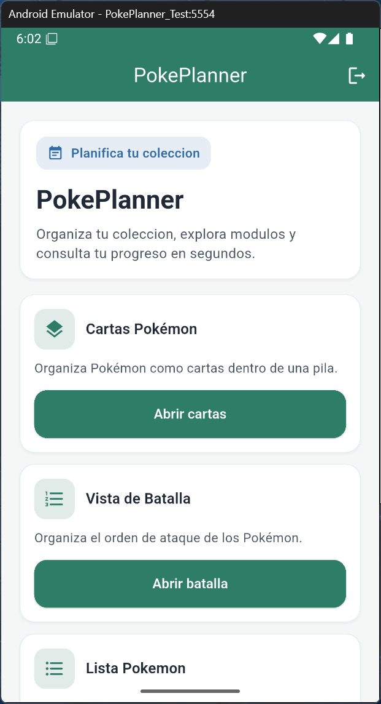
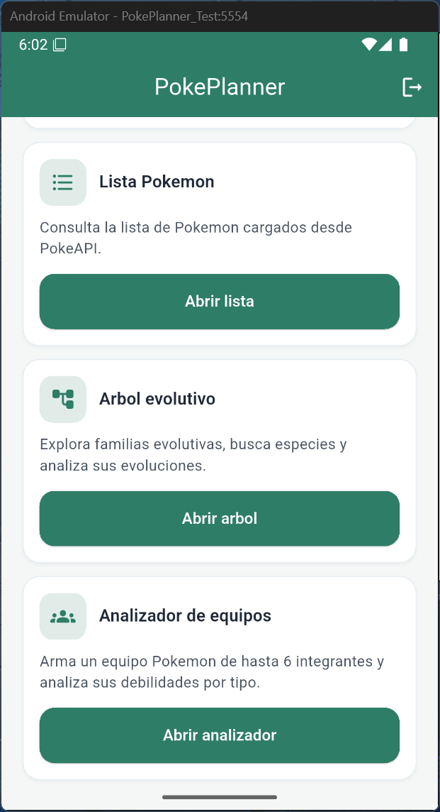
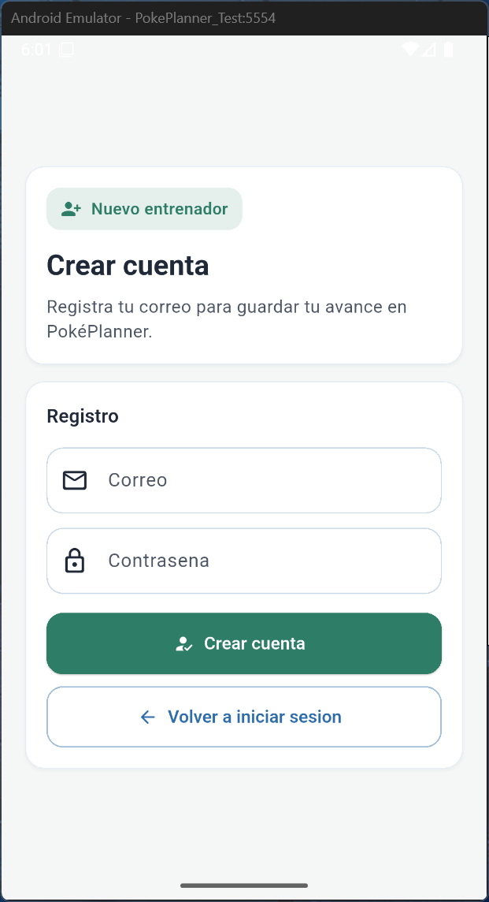
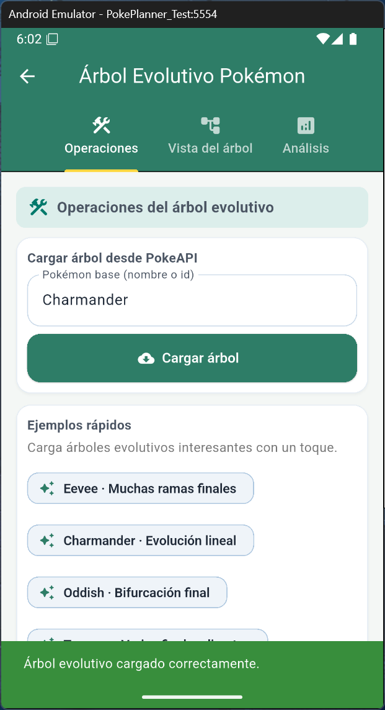
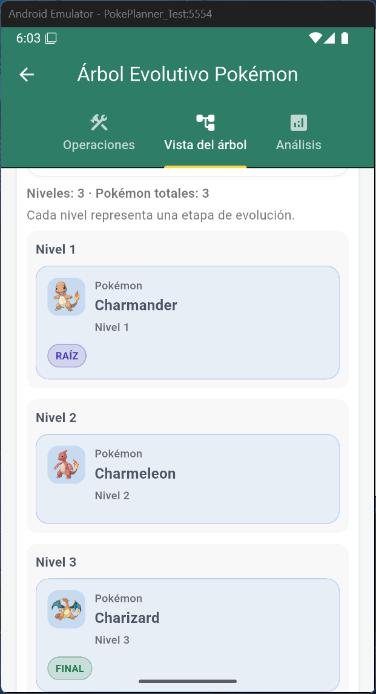
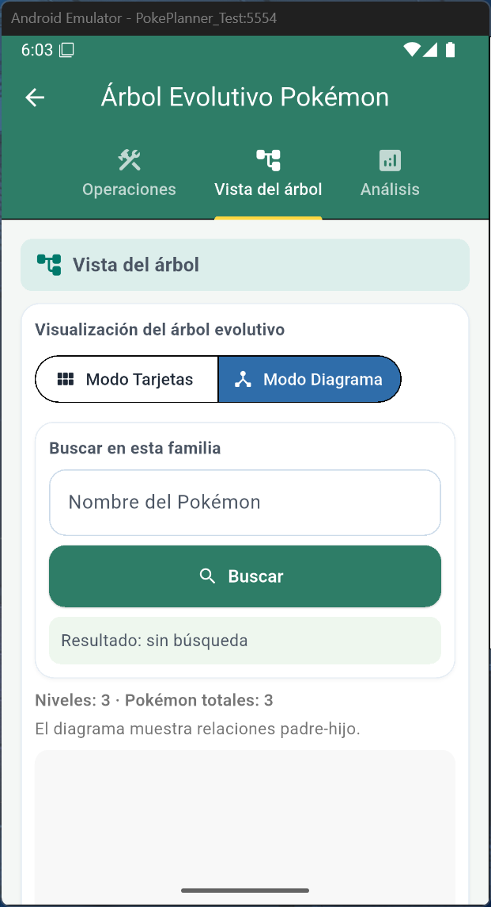

# PokéPlanner

Aplicación académica para organizar colecciones Pokémon y explorar estructuras de datos con información de PokéAPI.

## Vista previa

| Inicio | Módulos | Registro |
|:---:|:---:|:---:|
|  |  |  |
| **Operaciones del árbol** | **Evoluciones** | **Vista de diagrama** |
|  |  |  |

## Características principales

- Autenticación mediante Firebase Authentication.
- Cartas y turnos de batalla con estructuras de pila y cola.
- Organizador de colecciones mediante una lista enlazada.
- Exploración y análisis de árboles evolutivos con datos de PokéAPI.
- Analizador de equipos y tipos mediante tabla hash.

## Tecnologías utilizadas

Flutter, Dart, Firebase Authentication, PokéAPI y Git.

## Contexto y estado del proyecto

Proyecto colaborativo desarrollado para el curso universitario de Programación III, con fines educativos. El soporte de Firebase está configurado para Android; la integración en otras plataformas está pendiente. [Repositorio universitario original](https://github.com/DanielLeivaUMG/proyecto-final-progra3).

Para ejecutarlo, configura tu propio proyecto de Firebase para Android con FlutterFire y genera sus archivos de configuración; proporciona las URLs de PokéAPI mediante las variables de `.env.example`.

## Autor y colaboradores

- **[Daniel Alejandro Arita Leiva](https://github.com/DanielLeivaUMG):** árbol evolutivo, autenticación, identidad visual y ajustes de integración.
- **[Kevin García](https://github.com/KevinGarcia14):** pila de cartas y cola de batalla.
- **[Hetzon Agustín](https://github.com/HetzonL27):** lista enlazada, organizador de colecciones y base de integración con PokéAPI.
- **[Alexys Beza](https://github.com/alexys2006):** tabla hash, analizador de equipos y tipos.

Las aportaciones se resumen a partir de la documentación y el historial del proyecto; la lista de integrantes se presenta con los nombres disponibles en esas fuentes.
